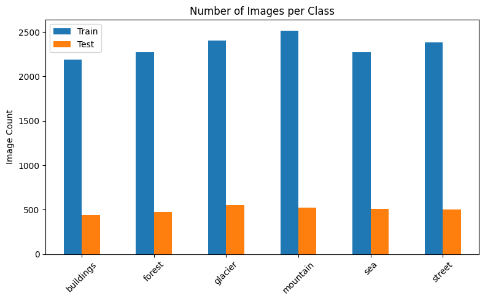
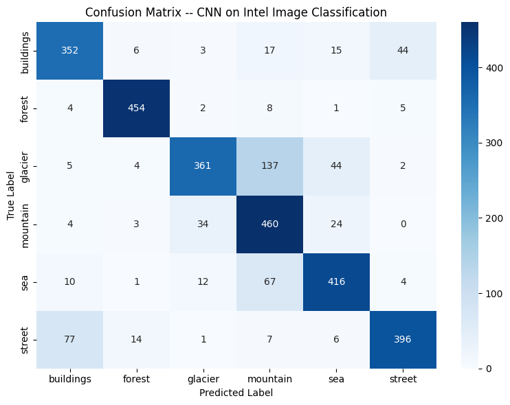

# Natural Scene Image Classification

A Convolutional Neural Network built from scratch with TensorFlow/Keras to classify natural scene images from the [Intel Image Classification dataset](https://www.kaggle.com/datasets/puneet6060/intel-image-classification) into **6 classes**:

`buildings` · `forest` · `glacier` · `mountain` · `sea` · `street`

The final model reaches **81.30% test accuracy** (macro F1 = 0.8156) on the 3,000-image held-out test set, without any pre-trained weights.

> A full written report with detailed analysis is available in [`report/Natural_Scene_Image_Classification_Report.pdf`](report/Natural_Scene_Image_Classification_Report.pdf).

---

## Table of Contents

- [Project Structure](#project-structure)
- [Dataset](#dataset)
- [Preprocessing Pipeline](#preprocessing-pipeline)
- [Model Architecture](#model-architecture)
- [Training Setup](#training-setup)
- [Results](#results)
- [Hyperparameter Experiments](#hyperparameter-experiments)
- [Installation & Usage](#installation--usage)
- [Limitations & Future Work](#limitations--future-work)
- [Author](#author)

---

## Project Structure

```
natural-scene-image-classification/
├── notebooks/
│   └── Natural_Scene_Image_Classification.ipynb   # Full training & evaluation notebook
├── outputs/                            # Artifacts generated by the notebook
│   ├── class_distribution.png
│   ├── training_curves(Baseline).png
│   ├── training_curves(LR=1e-4).png
│   ├── training_curves(Dropout=0.3).png
│   ├── confusion_matrix.png
│   ├── classification_report.txt
│   └── tuning_results.csv
├── report/
│   └── Natural_Scene_Image_Classification_Report.pdf   # Detailed written report
├── requirements.txt
├── .gitignore
└── README.md
```

The dataset and the trained model file (`intel_scene_cnn.keras`, ~60 MB) are not tracked in the repository — see [Installation & Usage](#installation--usage).

---

## Dataset

RGB scene photographs of 150 × 150 pixels, split into `seg_train`, `seg_test`, and `seg_pred` folders. Only the labeled `seg_train` and `seg_test` folders are used; `seg_pred` has no labels and is excluded from evaluation.

| Class     | Train | Test  |
|-----------|------:|------:|
| buildings | 2,191 |   437 |
| forest    | 2,271 |   474 |
| glacier   | 2,404 |   553 |
| mountain  | 2,512 |   525 |
| sea       | 2,274 |   510 |
| street    | 2,382 |   501 |
| **Total** | **14,034** | **3,000** |

The classes are close to balanced (about a 15% spread), so no resampling or class weighting was needed. `seg_train` is split 80/20 into **11,228 training** and **2,806 validation** images with a fixed seed (42).



---

## Preprocessing Pipeline

Built with `tf.keras.utils.image_dataset_from_directory` and `tf.data`:

1. **Resize** every image to 150 × 150, keeping all 3 RGB channels (color is a strong cue, e.g. sea/glacier vs. street/buildings).
2. **Integer labels** inferred from folder names (`label_mode="int"`), paired with sparse categorical cross-entropy.
3. **Normalization** of pixels from [0, 255] to [0, 1] with a `Rescaling(1/255)` layer.
4. **Performance**: `shuffle(1000)` on training data only, `cache()` to avoid re-decoding JPEGs, and `prefetch(AUTOTUNE)` to overlap loading with training.
5. The test set is **not shuffled**, so predictions align with labels for the confusion matrix.

---

## Model Architecture

A sequential CNN (`intel_scene_cnn`) with three convolutional blocks and a fully-connected head. Filter count doubles per block (32 → 64 → 128) so deeper layers learn progressively more abstract features.

```
Input (150, 150, 3)
│
├─ Conv2D(32, 3×3, same, ReLU) → BatchNormalization → MaxPooling2D(2×2)    → (75, 75, 32)
├─ Conv2D(64, 3×3, same, ReLU) → BatchNormalization → MaxPooling2D(2×2)    → (37, 37, 64)
├─ Conv2D(128, 3×3, same, ReLU) → BatchNormalization → MaxPooling2D(2×2)   → (18, 18, 128)
│
├─ Flatten                                                                 → (41,472)
├─ Dense(128, ReLU)
├─ Dropout(0.5)
└─ Dense(6, Softmax)
```

| | Count |
|---|---:|
| Total parameters | 5,403,462 (20.61 MB) |
| Trainable | 5,403,014 |
| Non-trainable (BatchNorm statistics) | 448 |

Over 98% of the parameters sit in the first Dense layer, a direct consequence of flattening the 18 × 18 × 128 feature map.

**Key components**

- **Batch Normalization** after each convolution stabilizes and speeds up training and adds a mild regularizing effect.
- **Max Pooling** halves spatial resolution, reducing computation and adding some translation invariance.
- **Dropout (0.5)** before the output layer is the main defense against overfitting.
- **EarlyStopping** (monitor `val_loss`, `restore_best_weights=True`) stops training once validation loss stops improving and keeps the best weights rather than the last epoch's.

---

## Training Setup

| Setting | Value |
|---|---|
| Loss | `sparse_categorical_crossentropy` |
| Optimizer | Adam, learning rate 1e-3 |
| Batch size | 32 |
| Max epochs | 30 |
| EarlyStopping patience | 5 (4 for tuning runs) |
| Random seed | 42 |

The baseline stopped after 15 epochs; validation loss reached its minimum (0.6059) at epoch 10, and those weights were restored.


---

## Results

Evaluated once on the held-out 3,000-image test set:

**Test accuracy: 0.8130 · Test loss: 0.5749**

| Class     | Precision | Recall | F1-score | Support |
|-----------|----------:|-------:|---------:|--------:|
| buildings | 0.7788 | 0.8055 | 0.7919 | 437 |
| forest    | 0.9419 | 0.9578 | 0.9498 | 474 |
| glacier   | 0.8741 | 0.6528 | 0.7474 | 553 |
| mountain  | 0.6609 | 0.8762 | 0.7535 | 525 |
| sea       | 0.8221 | 0.8157 | 0.8189 | 510 |
| street    | 0.8780 | 0.7904 | 0.8319 | 501 |
| **Macro avg** | **0.8260** | **0.8164** | **0.8156** | 3,000 |
| **Weighted avg** | 0.8254 | 0.8130 | 0.8132 | 3,000 |



**Observations**

- **Forest** is the easiest class (F1 = 0.9498) thanks to its distinctive dense green texture.
- **Glacier ↔ mountain** is the dominant error: 137 of 553 glacier images (about 25%) were predicted as mountain. Both show rocky, snowy terrain against sky, which is hard to separate at 150 × 150.
- **Buildings ↔ street** is a secondary confusion (77 street → buildings, 44 buildings → street), since street photos usually contain building facades.

---

## Hyperparameter Experiments

Each experiment trained a freshly initialized model for up to 15 epochs (EarlyStopping patience = 4), changing one hyperparameter at a time relative to the baseline.

| Experiment | Learning Rate | Dropout | Best Val. Accuracy |
|---|---:|---:|---:|
| Baseline | 1e-3 | 0.5 | 0.8158 |
| **Lower learning rate** | **1e-4** | **0.5** | **0.8186** |
| Lower dropout | 1e-3 | 0.3 | 0.7958 |

*"Best Val. Accuracy" is the highest validation accuracy observed during training.*

- **LR = 1e-4** gave the smoothest, most stable convergence and the best validation accuracy, although the widening gap between training accuracy (0.9093) and validation accuracy late in the run shows it begins to overfit.
- **Dropout = 0.3** lowered validation accuracy and produced a noticeably noisier validation loss curve, supporting 0.5 as the better dropout rate for this architecture.

| LR = 1e-4 | Dropout = 0.3 |
|---|---|
|  |  |

The saved model in this project is the **baseline** configuration. Since the experiments vary one parameter at a time, interaction effects (e.g. low LR with low dropout) were not explored.

---

## Installation & Usage

### 1. Clone the repository

```bash
git clone https://github.com/<your-username>/natural-scene-image-classification.git
cd natural-scene-image-classification
```

### 2. Create an environment and install dependencies

```bash
python -m venv venv
source venv/bin/activate        # Windows: venv\Scripts\activate
pip install -r requirements.txt
```

A GPU is recommended. The notebook was run on Google Colab with a T4 GPU (about 11 seconds per epoch after the first).

### 3. Download the dataset

Download it from [Kaggle](https://www.kaggle.com/datasets/puneet6060/intel-image-classification), or with the Kaggle CLI:

```bash
kaggle datasets download -d puneet6060/intel-image-classification
unzip intel-image-classification.zip -d archive
```

Expected layout:

```
archive/
├── seg_train/seg_train/<class folders>
└── seg_test/seg_test/<class folders>
```

### 4. Point the notebook to the data

Edit the `Config` class in the notebook:

```python
class Config:
    TRAIN_DIR = "archive/seg_train/seg_train"
    TEST_DIR  = "archive/seg_test/seg_test"
```

(Adjust the path to wherever the class subfolders actually live.)

### 5. Run the notebook

```bash
jupyter notebook notebooks/Natural_Scene_Image_Classification.ipynb
```

Run all cells. Plots, the classification report, the tuning table, and the trained model are written to `outputs/`.

### Using the trained model

```python
import numpy as np
import tensorflow as tf

CLASS_NAMES = ["buildings", "forest", "glacier", "mountain", "sea", "street"]
model = tf.keras.models.load_model("outputs/intel_scene_cnn.keras")

img = tf.keras.utils.load_img("path/to/image.jpg", target_size=(150, 150))
x = tf.keras.utils.img_to_array(img)[np.newaxis] / 255.0
pred = model.predict(x)
print(CLASS_NAMES[int(np.argmax(pred))])
```

---

## Limitations & Future Work

- **No data augmentation** was used. Random flips, small rotations, and zoom/crop are the most promising next step, especially for the glacier/mountain and buildings/street pairs.
- **A fourth convolutional block** (256 filters) could give the network more capacity to separate similar textures. Replacing `Flatten` with `GlobalAveragePooling2D` would also cut the parameter count drastically.
- **Joint hyperparameter search** (grid or random search over learning rate and dropout together) would capture interaction effects missed by one-at-a-time tuning.

---

## Author

**Rakan Majed Alharbi**

Dataset by Puneet Bansal, published on Kaggle under Intel's image scene classification challenge.
